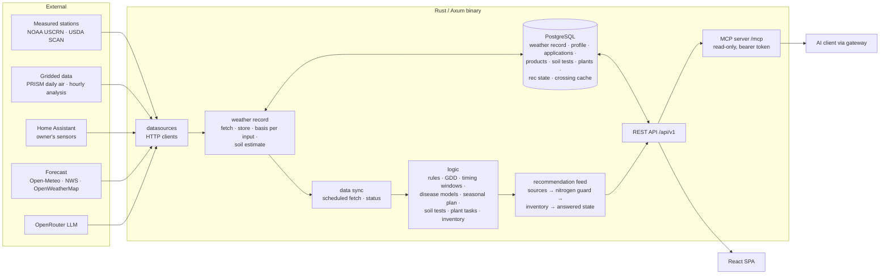

# High-Level Design: TurfOps

## Problem

Cool-season lawn care is a timing problem. Pre-emergent, seeding, fertilizer, grub control and fungicide each have a window that depends on soil temperature, accumulated heat, the freeze calendar and recent weather. Calendar-date rules of thumb miss those windows by weeks in either direction. Generic advice from extension sheets, product labels and lawn sites is not tied to the conditions at one particular yard. It also knows nothing about what has already been applied, so it can recommend a fungicide the lawn is already protected by, or a pre-emergent in a season that is being seeded.

A homeowner who wants to act on data has to pull together several things by hand: a weather station's soil probes, a forecast, a backyard sensor, their own application history and what is on the shelf. They then have to apply agronomic models they rarely have the time or training to run.

## Approach

TurfOps is a single-lawn web application that anyone can run on their own, anywhere in the contiguous United States. It joins the conditions at the lawn's location with the owner's application log, runs published agronomic models over both, and turns the result into one consistent set of recommendations.

### Conditions for the lawn's location

The owner gives the lawn's location. For each input (air temperature, soil temperature, humidity, rain, soil moisture) TurfOps uses the best basis available there:

1. **The owner's own sensors**, for the inputs they measure. An owner maps a sensor (an air or humidity sensor, a soil probe, a rain gauge) to an input; its readings are stored in the record like any other source, so they build a history of the lawn itself.
2. **A measured station**, where one is near enough to describe the lawn for that input: NOAA USCRN first, USDA SCAN second.
3. **An estimate for the location.** Daily air temperature and rain come from the PRISM grid. Soil temperature is modeled from that air series by a regression calibrated on the five nearest USCRN stations. Hourly air and humidity come from a gridded analysis.

The basis is chosen per input, not per installation, because how far a station's reading travels depends on what it measures:

| Input | Station used when within | Otherwise |
|---|---|---|
| Soil temperature | 50 miles | The modeled estimate |
| Soil moisture | 50 miles | Absent: it has no estimate worth showing |
| Hourly air temperature and humidity | 10 miles | The gridded analysis, labeled approximate |
| Daily air temperature (freeze dates, growing degree days) | Not used | PRISM at the lawn's point |
| Rain | Not used | PRISM at the lawn's point |

A station whose soil probe has failed still supplies its other inputs while soil temperature falls to the estimate. The owner can pin a station for an input in place of the default.

Every reading, date and tier carries its basis: measured at a named station and its distance, estimated for the location, or the owner's sensor. The estimate's error against measured stations is published in `docs/plans/standalone-weather-sources.md`.

TurfOps fetches these sources itself and keeps the hourly and daily record in its own PostgreSQL database, each value tagged with its source and basis. Every required source is free and needs no account or key. The forecast comes from Open-Meteo by default; the National Weather Service and OpenWeatherMap are selectable.

### Models, not heuristics

Each agronomic question has a named method:

- **Timing windows** (seeding, spring and fall pre-emergent) come from the location's own 15-year history of 5 cm soil-temperature crossings and freeze dates. Each historical year is dated separately, then summarized as a median and spread.
- **Disease risk** runs one published model per disease, with experimental ones flagged.
- **Seasonal rules** (grub control, nitrogen, broadleaf herbicide, irrigation, heat stress) are pure functions of conditions, growing degree days and the log.

Every method is written down in `docs/agronomy-methods.md` and `docs/timing-windows.md`, which are kept in sync with the code.

### One recommendation feed

Rules, timing windows, disease risk, landscape-plant tasks and application follow-ups all feed a single recommendation pipeline, in this order:

1. Each source produces its recommendations, marking any that ask the owner to apply nitrogen to the lawn as feedings.
2. A nitrogen guard holds marked feedings during active weather blocks and caps their nitrogen to the annual budget.
3. An inventory pass marks each recommendation on hand or need to buy, using the shelf.
4. The owner's past answers (addressed or dismissed, with escalation and expiry) are applied.
5. The feed is sorted by severity, most severe first.

The dashboard, the Recommendations page, the shopping list and the MCP server all read this same feed, in this same order.

Soil-test advice is not a feed source. It lives on the Soil Tests page and the MCP `soil_test_advice` tool. Lawns tested once every few years would otherwise have one aging test steering ongoing advice; it can join the feed, under the same nitrogen guard, once testing is regular.

### Application log as the memory of the lawn

What was applied, when, and from which shelf product drives protection windows, FRAC rotation, the nitrogen budget, the rule that seeding and pre-emergent never share a season, and task completion. The log is the source of these inferences. TurfOps does not ask the owner to keep separate settings in sync with it.

### Agent access through MCP

A read-only MCP server is built into the same binary. It exposes the REST handlers as tools, so an AI client gets exactly the answers the UI shows and can combine them with other servers behind the owner's gateway.

## Target Users

- **The lawn owner.** A homeowner in the contiguous United States managing a cool-season lawn (plus landscape plants), who runs TurfOps for themselves with a container runtime and no other infrastructure. They will not pay for a data service or sign up for one to get started. They log every application, want to know what to do this week and why, and will read the methodology. They do not want to re-enter state the app could infer.
- **An AI agent acting for the owner.** Reaches TurfOps through the MCP gateway to answer questions and combine lawn state with other data. It needs model-readable, trimmed results and must not be able to change anything.

## Goals

- Every surface (dashboard, Timing, Disease Risk, Seasonal Plan, Calendar, Recommendations, shopping list, MCP) gives the same answer for the same day and lawn.
- TurfOps runs with only its own image and a PostgreSQL database. A location is the only weather setting it needs.
- A new owner is walked through setup in the app: give the location, see which sources were found for it and how far away they are, optionally map their own sensors, and watch the history load. Nothing about the lawn has to be looked up and typed into a configuration file.
- The owner can see, for every input, which source is in use, what stands behind it, how fresh it is and how accurate the estimate is, and can change the choice.
- Every weather-dependent answer says what it rests on: a named station and its distance, an estimate for the location, or the owner's sensor.
- Timing-window dates come from the location's own record, and the spread between years is shown alongside the median.
- Disease advice says what is protected, what is not, and which FRAC class to use next without repeating the last one, all based on what was actually logged.
- Recommendations reflect the shelf: each says whether the product is on hand, and the shopping list lists only what active advice requires.
- The weather record keeps itself current. TurfOps fetches each source on that source's own publishing schedule, whether or not anyone is viewing, so a page never waits on a download and the record has no holes from days nobody looked.
- Losing one data source (a station network, the grid, Home Assistant, the forecast provider, OpenRouter) degrades only the features that depend on it. A station outage falls back to the estimate, labeled as such. Nothing else breaks.
- Every error the owner sees is plain language that says what went wrong and, where there is one, what to do about it. Raw status codes, JSON bodies, upstream response bodies and internal details never reach the screen; they stay in the log.

## Non-Goals

- **Multi-tenant or commercial use.** One lawn and one owner per installation, self-hosted. A commercial or hosted product is a separate codebase; some of the free data sources allow only non-commercial use.
- **Lawns outside the contiguous United States.** The grid behind the estimate and the station networks cover the lower 48.
- **Sources that need payment, an account or a key to get started.** A keyed source may be offered as an option, never required.
- **Label rates.** Advice never states a product's label rate, and never any rate for a pesticide (fungicide, herbicide, insect control). The label governs product use. Agronomic amounts are part of the advice: nutrient per 1,000 sq ft (the nitrogen budget is kept in lb N/1,000 sq ft), lime or sulfur from a soil test, seed per 1,000 sq ft, mulch depth. A nutrient or soil-correction amount may also be expressed as an amount of a specific fertilizer or soil-amendment material (pounds of a fertilizer from its analysis, Epsom salt for magnesium), but a material that is also a pesticide active (copper sulfate, for example) is given only as the nutrient amount. A label rate the owner records (optionally suggested by the LLM) pre-fills the application form; the MCP assistant may report it when the owner asks about that product, as the owner's recorded value with "verify against your label". It never appears in advice.
- **Quantity tracking.** Shelf stock is a hand-set In stock / Low / Out, with no amounts or usage math.
- **Warm-season lawns.** TurfOps serves cool-season lawns; `Mixed` is a cool-season blend. The profile accepts warm-season grasses, but no behavior for them is designed or supported, and whatever the code does for one is not intent.
- **An estimate where a measurement is available.** A station within the cut-off for an input, or the owner's sensor, is never replaced by the estimate while it is reporting.
- **Estimated soil moisture.**
- **Writes through MCP and in-app chat.** Agents read. The owner changes state through the UI.
- **LLM-generated agronomic advice.** The LLM writes landscape-plant care plans and product profiles only. Recommendations come from deterministic code.

## Tenets

*Ordered: when two conflict, the higher one wins.*

- **One answer everywhere.** When a new method covers ground an existing one covers, it replaces the old one rather than running beside it. Each answer comes from a single source that every surface reads.
- **Withhold rather than invent.** When neither a measurement nor an estimate of known accuracy can support a date, tier or alert, show none and say why. An estimate earns its place only by being scored against measured stations; a plausible guess does not. (The calendar fallback for stale data is labeled as such.)
- **Measured where it is near, estimated where it is not, always labeled.** Prefer a nearby measured record, with its lag and gaps, over a gapless estimate. Past the distance where a station stops describing the lawn, prefer an estimate for the location over a far station's reading. Lag and basis are disclosed rather than hidden.
- **The product stands alone.** A design choice is judged by what suits someone installing TurfOps fresh, not by what any one owner's surrounding infrastructure makes convenient.
- **Infer from the log, not from settings.** When a fact about the lawn can be read from the application log, derive it there instead of adding a toggle or field the owner must keep current.

## System Design

**Components** (each a node under `docs/intent/`; Weather data access and Disease risk are sub-HLDs over child leaves):

| Component | Responsibility |
|---|---|
| Weather data access | Fetches station, grid, sensor and forecast data and keeps the hourly and daily record in PostgreSQL. Chooses the basis for each input from the lawn's location, produces the soil-temperature estimate, and serves the live reading, daily aggregates and climate record with their basis, bucketed by the lawn's local date. Owns the read-only environmental views: the Environmental page, `/historical`, and the 10 cm soil-temperature outlook. Children: weather sources, soil-temperature outlook, environmental views. |
| Data sync | Runs the fetch schedule: each source on its own publishing cadence, the history backfill when a location is set, and catch-up after downtime. Keeps the last good values across failures. Reports connection and freshness status (`/health`). |
| Agronomic rules | Ten pure rule functions over the environmental summary, GDD and the log, the nitrogen guard, GDD accumulation, and the annual nitrogen budget. |
| Timing windows | Seeding and pre-emergent windows: boundary definitions, per-year crossings, climatology, resolving this season's state, recommendations and seasonal-plan activities. |
| Disease risk | Per-disease models, tiers, headline fallback, management programs, the FRAC efficacy matrix, protection windows and rotation. Children: risk models, management, disease UI. |
| Seasonal plan and calendar | Predicted activity windows from historical crossings, merged with timing-window activities. Calendar overlay of plan and log. |
| Recommendation feed and state | Gathers every source, runs the enrichment passes, and applies the answered-state policy (escalation and expiry). |
| Applications | The lawn profile and the log: types, FRAC classes, product links, the duplicate key, nitrogen accounting, follow-up reminders. |
| Product inventory | The shelf: categories, user-owned facts, LLM profile, product needs, enrichment, shopping list. |
| Soil tests | Recorded tests and pH, N-P-K and micronutrient advice, shown on the Soil Tests page and through MCP (not in the recommendation feed). |
| Landscape plants | LLM care plans, maintenance windows, watering hold-back. |
| MCP server | Tool router over the REST handlers, trimming, doctrine and methodology resources, bearer auth. |
| Web UI | Dashboard, the pages and their widgets, status palette and accessibility conventions. |
| Setup and sources | The first-run setup flow and the Sources page: the location, the sources found for it, station pins, sensor mapping, forecast provider, per-source freshness and history, the estimate's published accuracy and each source's attribution. |
| Deployment | Multi-stage Docker image (distroless runtime), the environment configuration surface, and an example Compose file (app + PostgreSQL) that is a complete installation. The owner's own deployment is separate; nothing in the repo is tied to it. |

## Key Design Decisions

| Decision | Alternatives considered | Rationale |
|---|---|---|
| TurfOps fetches its own weather data and keeps it in PostgreSQL, each value tagged with source and basis. | Reading parquet files a separate pipeline maintains; the app writing such files to a volume and querying them with embedded DuckDB; a separate ingester container. | An installation must be complete with the app and its database. Every installation already has PostgreSQL, so the record needs no extra volume, service or backup. The record mixes sources of different shapes (hourly station data, a daily grid, a modeled soil series), which rows with a source tag hold directly and a single-station file layout does not. |
| The basis is chosen per input, each with its own station cut-off: 50 miles for soil, 10 miles for hourly air and humidity, and no station for daily air or rain. | One basis per installation; one cut-off for every input; the nearest station at any distance; the estimate everywhere. | Across USCRN station pairs, a neighbor's soil-crossing dates agree to within a few days up to about 60 miles and are no better than the calendar past 100; about half the US population lives within 50 miles of a USCRN or SCAN station. Air is different: beyond about 5 miles a neighbor's last-spring-freeze date misses by 15 to 19 days in a bad year against 4 to 9 for PRISM at the point, and an airport 9 to 20 miles away counted humid hours no better than the gridded analysis. Per-input choice also keeps a station's good sensors when one of its probes fails. |
| Rain comes from PRISM daily precipitation at the lawn's point. | The hourly analysis; a station's gauge. | Against 133 station gauges PRISM's 7-day total was off by 4.5 mm and caught 88 % of weeks with 25 mm or more; the hourly analysis was off by 8.2 mm and caught 75 %. Rain varies over shorter distances than any station network resolves. |
| The estimate is PRISM daily air temperature plus a soil regression calibrated on the five nearest USCRN stations. | Reanalysis soil and air temperature (Open-Meteo archive, ERA5-Land); copying the nearest station's dates; a regression pooled over all stations. | Scored against 133 USCRN stations, PRISM dates freezes and GDD within about a week at the 80th percentile, and the nearest-five regression dates soil crossings within about two. Reanalysis put the first fall freeze two to three weeks late and spring soil warming about five days early. |
| Sources are fetched on a schedule, each on its own publishing cadence. | Fetching only when someone views a page. | Stations and grids publish hourly or daily and the models need an unbroken record. Fetching on view makes the first page after a quiet spell wait on downloads and leaves the owner's own sensors with no history between visits. |
| Soil moisture is never estimated. | A reanalysis or water-balance estimate. | No free estimate was found accurate enough to drive irrigation or fertilizer advice. Rules that use soil moisture fall back to rainfall and the forecast. |
| Every required source is free and keyless; the forecast defaults to Open-Meteo. | OpenWeatherMap (needs a key) as the only forecast; the National Weather Service as the default. | A first run must work with nothing to sign up for. Open-Meteo gives hourly data for 16 days including humidity and rain; the NWS forecast is shorter and gives rain amounts for about 3 days. Both remain selectable, as does OpenWeatherMap. |
| Date timing windows per historical year, then summarize as median / p10 / p90. | One averaged climatological curve. | An averaged curve hides year-to-year spread and can cross a threshold on a date no real year did. Per-year dates give an honest range and allow years with sensor gaps to be dropped. |
| Use 5 cm soil temperature for timing windows. | 10 cm. | Germination of crabgrass and turf seed tracks the surface layer. |
| Keep each disease model on its own score, comparable only through the Low / Moderate / High / Severe tier. | One blended disease-pressure score. | The models measure different things (E-index, probability, criteria score). A blend would look precise without meaning anything. |
| Keep agronomic logic in pure functions with no I/O. | Rules that query the data they need. | Pure functions are testable against fixed inputs, run the same for every caller, and degrade cleanly when an input (such as GDD) is missing. |
| One recommendation feed with ordered enrichment passes. | Each page computing its own alerts. | It is the only way to guarantee every surface agrees. Answered state applies after enrichment so escalation compares against what the owner would see; the feed is sorted once, so every surface lists it in the same order. |
| Soil-test advice stays out of the feed. | Soil-test advice as a feed source. | The owner tests soil rarely. A single test, often years old, should not keep producing feeding and amendment alerts; the Soil Tests page shows its advice alongside its date. |
| Sources mark feedings; the nitrogen guard covers what is marked. | A fixed list of feeding ids in the guard. | One id can carry feeding and non-feeding advice (red thread says "feed" only while the lawn is nitrogen-hungry), and a new feeding source must not be able to escape the guard by having an id the guard does not know. |
| An answered recommendation returns when it escalates or its episode ends. | Permanent dismissal; recommendation ids that include the year. | Permanent dismissal hides a worsening risk. Episode expiry (weather 7 days, disease 21 days, seasonal 120 days) brings advice back when it is relevant again without rules having to encode years. |
| Seeding and pre-emergent are mutually exclusive per season, inferred from the log. | A per-season setting. | Pre-emergent kills new seedlings. The log already records which one happened. |
| No stock quantities. | Tracking amounts and deducting per application. | Hand-set In stock / Low / Out answers "do I need to buy this" without bookkeeping the owner will not keep up. |
| AI access through a read-only MCP server inside the app. | An in-app chat UI with a fixed context snapshot. | The AI client already provides the agent loop and UI. Pulling data through tools beats a fixed snapshot, and it combines with the owner's other MCP servers. Read-only limits the damage a wrong call can do. |
| The LLM supplies product facts and plant care plans, with curated data taking precedence. | LLM-authored recommendations. | Advice must be reproducible and match the documented methods. The curated FRAC resolver beats the LLM's FRAC list, and the owner's edits beat both. |
| Agronomic amounts in advice, never label rates. | No amounts at all; showing typical label rates. | Nutrient, lime and seed amounts are agronomy and do not depend on the product: the nitrogen budget and soil-test corrections cannot be expressed without them. How much of a product to apply is set by its label, which is the legal authority, above all for pesticides. Converting a nutrient amount into an amount of a fertilizer or amendment material is still agronomy; for a material that is also a pesticide active, the label governs, so only the nutrient amount is given. |
| Choices about the lawn are made in the app and stored in PostgreSQL; the environment holds only what the app needs before it can start. Everything else an environment variable can say about the lawn or its sources is a first-run seed. | Everything in environment variables; everything in the app. | The location, a pinned station, a sensor's mapping and the forecast provider depend on things the app has to compute and show (which stations are near, how far, what a Home Assistant instance offers) and must change without a restart. The database connection has to exist before any page does. A credential for an optional service (Home Assistant, a keyed forecast provider) is entered in the app and stored write-only: saved, used, and never shown or returned again. Requiring the environment would make a new owner edit a configuration file and restart before setup could find their sensors. `LAWN_*` variables, the location among them, and the Home Assistant and forecast credentials seed a first run, so a Compose-only install comes up configured; after that the app's stored values are the only ones, and no environment value overrides them. A setting with two sources needs a precedence rule and a way to show which one won; a seed needs neither. |
| "Today" and every date gate use the lawn's local date, in the timezone that follows from the lawn's location. There is no timezone setting. | The UTC date; a station's own local date; the viewer's browser date; a timezone setting in the environment or the app. | Observations are stored in UTC, but every agronomic date (a window's day, a freeze night, a residual window, a year boundary) is a lawn-local calendar day. The zone follows from the location, and a second setting could only agree with it or contradict it. One clock gives every component the same day and the same instant (nothing reads the process clock for a judgment, so a test can stop the app's clock on any date), and hourly observations are bucketed into those same local days, daylight-saving aware. Sources that publish only daily values (the grid) are taken as that source's day. |

## Success Metrics

- **Agreement.** For any day, the dashboard, Timing, Disease Risk, Seasonal Plan, Recommendations and MCP `lawn_snapshot` show the same state for the same window or disease. *Falsified by* any surface disagreeing with another.
- **Stands alone.** A fresh installation given only a location produces a dashboard, timing windows and disease risk. *Falsified by* any required key, account, mounted file or second service.
- **Basis disclosed.** Every weather-dependent value in the UI and MCP results names its basis. *Falsified by* an estimated value shown without the label, or a station value shown without the station and distance.
- **Estimate accuracy.** At measured stations, the estimate reproduces soil-crossing and freeze dates within the errors published in the research. *Falsified by* a re-score that exceeds them.
- **Reproducibility.** Typical timing-window dates match an independent SQL reproduction over the same stored record. *Falsified by* a mismatch not explained by documented gap filtering.
- **No invented answers.** No recommendation carries a date, tier or rate the data does not support. *Falsified by* an overdue boundary showing a date, or any advice text stating a product label rate or a pesticide rate.
- **Polite fetching.** Each source is asked no more often than it publishes, and unchanged data is not downloaded again. *Falsified by* a source being polled faster than its update cadence, or a full re-download where a conditional request would do.
- **Graceful degradation.** Taking down any one data source removes only the features that depend on it. *Falsified by* a station outage blanking unrelated pages or a forecast failure erasing observed data.
- **Test gate.** The backend test suite, clippy, the TypeScript build and the Biome lint all pass before merge.

## References

- `docs/agronomy-methods.md`: thresholds and models, kept in sync with code (also served as an MCP resource).
- `docs/timing-windows.md`: full timing-window method and deliberate differences from lawn-answers.com.
- `docs/plans/`: feature plans (product inventory, AI assistant / MCP, Open-Meteo forecast, USCRN soil dropout investigation).
- `docs/plans/standalone-weather-sources.md`: the source survey, station coverage and accuracy tests behind the tiered weather design.
- NOAA U.S. Climate Reference Network; USDA NRCS Soil Climate Analysis Network (SCAN); PRISM Climate Group daily grids, served by RCC-ACIS; Open-Meteo.
- University of Kentucky PPA-1, *Chemical Control of Turfgrass Diseases* (2024): source of the FRAC efficacy ratings.
- Smith-Kerns dollar spot model; Fidanza brown patch E-index; Nutter Pythium criteria.
- lawn-answers.com Turf Tools: reference for the seeding, pre-emergent and disease tools.
